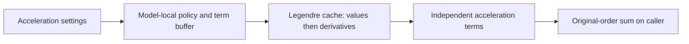

# Parallel spherical-harmonic gravity: implementation contract

Status: native and Python implementation; validation updated 20 November 2026. Model-local thread configuration, reusable storage and the optional OpenMP
backend are available through the ordinary Python factory. Separate complete
native-library/kernel builds with OpenMP ON and OFF have been exercised.
The [Python benchmark](../benchmarks/PYTHON_SPHERICAL_HARMONICS.md) measures
2.41x dynamics-only and 1.55x variational integration speedup at four requested
threads on its degree/order-100 Mars workloads. The earlier 2.17x number belongs
to the feasibility executable and is not the native acceptance measurement.
The historical resource blocker has been resolved. Broad-suite results and
optional-serialization test selection are recorded below; this is not a claim
that every acceptance gate or build-option combination has been tested.

## Current native entry points

```cpp
// Existing arguments retain their positions; the fourth argument is opt-in.
auto settings = tudat::simulation_setup::sphericalHarmonicAcceleration(
    100, 100, false, 4 );
// For a directly constructed native acceleration model:
model.setNumberOfThreads( 4 );
```

The ordinary acceleration factory transfers the settings into the new model.
`getNumberOfThreads()` reports the requested policy on a model/cache, not the
actual OpenMP team size. The model owns its term vector; its Legendre cache owns
its polynomial/derivative vectors and policy. A mutable model is still for one
caller at a time. Different models may run on different outer threads, with an
explicit combined thread budget chosen by the caller.



The settings configure one model and its cache. Completed cache phases precede
independent force terms; the final summation remains on the caller. No model
callbacks are invoked in the inner teams.

Configure with `-DTUDAT_BUILD_WITH_OPENMP=ON` to enable the optional backend.
OFF is the default and rejects explicit multi-thread requests. Library targets
export the feature definition and, when enabled, `OpenMP::OpenMP_CXX`; the
installed package config discovers OpenMP for consumers. No global OpenMP
settings are changed. Each worker failure is captured, the region joins, and
the caller receives the exception. A failed cache/model update invalidates its
input/time marker. Team creation is bypassed within an active OpenMP region.

The earlier experiment hooks remain compile-guarded for feasibility comparison;
normal native builds do not enable their macros or use their global controls.
Do not mix these new model/cache definitions with old library objects: rebuild
all consumers, including Python bindings, before using them together.

## Scope and branch boundaries

The first implementation covers the spherical-harmonic acceleration sum and
its Legendre values/derivatives, for the existing translational gravity model.
It preserves the force model, coefficients, frames, integrator, output and term
accumulation order. Hessian parallelization remains an isolated reference
experiment and is not enabled as part of this feature.

`experiment/parallel-spherical-harmonics` is a sufficiently specific branch
name for this work. The experiments and first production integration can remain
on that branch; changing its prefix to `feature/` later is optional bookkeeping.
It is based on develop and does not require the independent-arc PR to function.

Panelled aerodynamics and radiation pressure are a separate force family and
should receive a separate experimental branch, for example
`experiment/parallel-panel-forces`. Choose its base from the actual dependencies
at that time. Prefer develop when independent; only stack it on this work if it
really reuses an unmerged implementation. Do not combine unrelated force-family
changes into one gravity PR. Free-threaded Python is outside both tasks.

## User-facing configuration

Use an explicit, model-local number of threads, defaulting to one. The Python
factory accepts an additional optional keyword:

```python
gravity = propagation_setup.acceleration.spherical_harmonic_gravity(
    maximum_degree=100,
    maximum_order=100,
    number_of_threads=4,
)
```

Existing calls, including the point-mass-removal option, retain their meaning.
The C++ settings constructor/factory receives a matching optional thread count
without reordering current parameters. Reject zero/negative counts. Do not
silently select all CPUs or promise that a requested team is always available.
The requested count is an upper bound subject to runtime resource limits;
benchmarks should record actual team size separately.

The acceleration factory transfers this policy into each newly created native
model and its own spherical-harmonics/Legendre caches. No `omp_set_num_threads`,
process-global enable switches or diagnostic counters belong in the public
implementation. Changing one model must not change another model's policy.

Thread count is a local execution policy, not a physical estimated parameter.
The native implementation keeps the existing scientific archive schema:
execution policy is not persisted in old acceleration-setting archives and
loads default to one thread. Document this explicitly on the factory/property
and cover it in roundtrip tests. Equality of the scientific settings retains
its existing meaning. Persisting execution policy would require a separately
designed archive-format/versioning change; do not silently append a binary
field or pretend old archives contain it.

## Ownership and numerical execution

Each model/cache owns its execution configuration and scratch storage. Copies
must have independent mutable scratch buffers. There is no shared mutable
scratch table between accelerations, bodies, arcs or solvers. As in the existing
API, a single mutable model/cache cannot be evaluated concurrently by unrelated
callers without external synchronization.

Retain the established dependency order:

1. Set the latitude input and compute sectoral diagonal values serially.
2. Compute independent vertical recurrences by order, retaining each column's
   degree order. Finish all columns before derivative work.
3. Compute first derivatives by independent rows and complete that pass.
4. Compute second derivatives only when required, after the first derivatives.
5. Complete the spherical cache update before acceleration-term workers read it.
6. Compute independent gradient terms into model-owned storage, then add them
   in the original degree/order sequence on the caller.

Reuse scratch allocation across evaluations; resize safely when coefficient
limits change. Preserve finite-value/shape checks and the original near-pole
and saved-per-term-output behaviour. Initial production support may retain
serial fallbacks for those branches, but must document and test them.
No SPICE, Python callbacks or numerical-integration steps run in the inner team.

Do not infer a universal workload threshold from measurements at degrees 50
and 100 alone. Start with explicit opt-in. Any later automatic threshold needs
its own measured crossover and documented semantics.

## Failure handling and parallel composition

Every worker exception must be captured inside the parallel region, all work
must finish/join, and the caller must receive the failure afterwards. Never
allow a C++ exception to escape an OpenMP worker region. Preallocate required
scratch/error storage on the caller where possible. A failed cache update must
invalidate its cached-input marker so a retry cannot accept partially computed
values as complete.

One thread follows the ordinary sequential path without creating a parallel
region. A call made inside an existing OpenMP parallel region should use a
serial inner path initially. This does not detect independent arcs implemented
with `std::thread`: callers combining both levels must explicitly budget outer
workers and inner threads. Default inner count one avoids accidental nesting;
this feature must not introduce a dependency on the independent-arc scheduler.

With an optional OpenMP backend, an explicit request for multiple threads in a
build without that backend raises a clear configuration error before
propagation. Do not pretend that the request succeeded or silently change the
scientific model.

## Build integration

Introduce a documented optional build flag, disabled by default, and discover
the compiler's OpenMP C++ target through CMake. Propagate its compile/link
requirements to targets instantiating the relevant header code and to installed
Tudat consumers. Export the matching feature information. Keep normal builds
free of the dependency when the option is OFF.

The acceptance build must compile the native libraries and actual Python
bindings consistently from the updated source. Standalone replacement objects
and reused libraries are useful for feasibility measurements, but cannot serve
as acceptance evidence once cache/model layouts change. Do not mix objects from
incompatible definitions of those classes.

## Acceptance gates

- Before exposing/releasing the feature, add the OpenMP build option and compiler
  requirements to the regular installation documentation, and document the
  per-model thread setting in the user/API documentation. Explain both defaults
  (backend OFF; one thread per model even when ON), the unsupported-backend error,
  and budgeting inner threads together with outer arc workers. This developer
  contract alone is not sufficient user documentation.
- Test validated defaults and object-local policy transfer through C++ and the
  existing Python acceleration factory. Check that separate models do not
  inherit each other's settings or share scratch buffers.
- Compare Legendre values/derivatives against the unchanged serial route for
  full/truncated order, normalized/unnormalized coefficients, cache reuse,
  degree/order changes and near-pole inputs. Test both error and retry paths.
- Compare force values and all saved states/STM/sensitivities for representative
  dynamics and variational propagations. Preserve the current tolerances;
  report observed equality without promising cross-platform bitwise identity.
- Test saved-per-term output, serial fallbacks, unsupported-backend errors,
  scientific-setting serialization defaults and nested/concurrent-model cases.
- Build OFF and ON configurations from consistent sources; run native gravity,
  Legendre and integration tests plus the full offline Python suite. Record any
  external resource blocker explicitly rather than adding ad hoc exclusions.
- Remeasure setup and complete integration with 1/2/4/8 threads, rotating order
  and reporting medians/ranges. Confirm numerical results for every run and
  assess regressions on small workloads. Do not make a fixed speedup a portable
  test assertion.

The contract and experiments are AI-assisted. Maintainer review should focus on
cache ownership, recurrence dependencies, failure recovery, archive semantics
and build/export consistency before exposing the production API.

## Focused native validation

Separate fresh native OFF and ON build directories are used; the earlier Python
build directories are untouched. The focused targets are:

```bash
cmake --build build-gravity-native-on --parallel 4 --target \
  test_gravitation_ParallelSphericalHarmonics \
  test_basic_LegendrePolynomials test_basic_SphericalHarmonics \
  test_gravitation_SphericalHarmonicsGravityModel
ctest --test-dir build-gravity-native-on --output-on-failure \
  -R '^(test_gravitation_ParallelSphericalHarmonics|test_basic_LegendrePolynomials|test_basic_SphericalHarmonics|test_gravitation_SphericalHarmonicsGravityModel)$'
```

Repeat in an OFF build. The new test covers policy validation, cache values and
first/second derivatives, checked/unchecked access, independent cache copies,
worker exceptions and retry, buffer resizing/NaN overwrite, per-term-output and
near-pole fallbacks, independent outer threads, nested OpenMP fallback, unchanged
scientific archive bytes with policy reset on load, and a 500-step propagation
using Tudat's RK4 integrator. Exact-pole finite acceleration is not newly promised:
the existing serial path is non-finite at the exact-pole fixtures; fallback tests
use finite points near each pole.

These are focused native gates, not a full solver/binding acceptance report.
Factory-to-solver state/STM/sensitivity integration, Python exposure, complete
native-library/kernel builds and remeasurement are now covered by the Python
validation described below. Installed-consumer execution is now covered as
described below. The earlier missing Earth-orientation resource was restored
through the official Conda package on 20 November; see the broad-suite update.

## Python validation and measurements

The ordinary Python factory accepts keyword-only `number_of_threads=1`, exposes
its requested value as a read-only settings property, and provides
`acceleration.is_openmp_available()`. Current lifetime/GIL rules are unchanged;
a custom Python rotation callback is tested for caller-thread execution and
native ownership after local Python references are deleted.

The regular [installation page](tudatpy/source/installation_openmp.rst) and
[acceleration API page](tudatpy/source/dynamics/propagation_setup/acceleration.rst)
now document availability, both defaults, errors, ownership, callback handling,
archive reset and combining outer workers with inner threads. A focused strict Sphinx build of the new installation page and bound API
docstrings passes; a full site build has not been claimed.

The test `tests/test_tudatpy/test_parallel_spherical_harmonic_gravity.py` exercises
both backend configurations. In the current builds OpenMP ON has Cereal OFF
(9 pass, one explicit pickle skip), while OpenMP OFF has Cereal ON (10 pass,
including pickle). Four native CTest targets also pass in each configuration.
The benchmark exercises 24 longer propagations, comparing every state, STM and
Mars-mu sensitivity entry against a sequential reference; all observed maximum
absolute differences are zero. The older complete Python kernel was also run
as a sequential control, with no observed result differences or evidence of a
sequential slowdown. See the benchmark report for absolute times and limits.

Historical status on 15 November: the normal unfiltered `--no-remote-data`
suite stopped at collection because
`earth_orientation/eopc01_polar_motion_1846-1961.txt` was absent. A diagnostic
run using `--continue-on-collection-errors`, after `copy_test_data`, gives
824 passed, 45 failed, 96 skipped, one xpassed and seven errors. Its failures
include the missing resource and two GRAIL/MRO fixture downloads blocked in the
sandbox. Repeating those two tests with network access successfully retrieves
the fixtures and reaches the same missing Earth-orientation resource. These
failures are recorded rather than hidden with exclusions. This diagnostic is not a
passing full-suite result. Logs, raw timings, configuration and hashes are local
under `local-profiles/20261115/python-gravity/`.

## Installed C++ consumer validation

The standalone project in `tests/installed_gravity_consumer/` configures with
`find_package(Tudat CONFIG REQUIRED)` against actual separate ON/OFF install
prefixes. It links installed gravity/math targets, with the package registry
disabled and no source/build include directories or hand-added OpenMP flags.
Both configurations compile, link and pass CTest. The ON consumer observes four
threads in the installed loop helper and matches sequential force values over
20 changing positions. The OFF consumer remains sequential and rejects a
multi-thread request. Config/target feature-definition agreement is checked.
Installed library hashes match their freshly built counterparts; compile/link
commands are checked for checkout/build-path leakage.

This exposed and fixed missing installed dependency discovery/propagation:
ship `FindCSpice.cmake`, discover Eigen and NRLMSISE-00, export Eigen's header
requirements and expose Cereal from the public gravity headers. No numerical
implementation changed. The production-only installs use `TUDAT_BUILD_TESTS=OFF`
to avoid requiring unbuilt test-support artifacts from kernel-only builds.
See `tests/installed_gravity_consumer/README.md` for reproduction and scope.
This validates configured install prefixes, not relocating an installed package.
Logs are local under `local-profiles/20261115/installed-consumer/`.

## Serialization-aware test collection (20 November 2026)

The kernel reports its actual compiled `TUDAT_BUILD_WITH_SERIALIZATION` option
as the boolean `_build_with_serialization` attribute. The pytest collection hook
uses that flag for `requires_serialization` tests. Only an explicit false value
skips those tests; a missing or non-boolean flag raises a usage error requiring
a rebuilt kernel and an import-path check. A nearby CMake cache, an environment
variable or a missing binding method is not evidence that serialization is off.

The file-I/O suite and Cereal-dependent pickle classes carry the marker. Time's
independent tuple-pickle tests remain active. The new gravity-settings pickle
test uses the same marker instead of treating a missing method as a reason to
skip. With serialization ON, a broken/missing binding therefore remains a test
failure. Regression cases cover both booleans, unknown flags, selective
collection and agreement between the loaded flag and the basic bindings.

This reuses the policy already present on `parallellization_inquiry`, without
merging its arc code or unrelated serialization-test refactoring. No Cereal
payload, equality implementation, gravity algorithm or comparison tolerance is
changed. Both kernels were rebuilt successfully and their import paths and
boolean flags checked before running the full offline suite:

| OpenMP | Cereal serialization | Full offline Python suite |
|---|---|---|
| ON | OFF | 672 passed, 329 skipped (24.29 s) |
| OFF | ON | 885 passed, 115 skipped, 1 xpassed (24.04 s) |

Neither run has failures or errors. Both execute all 11 policy regression cases
and the three independent Time pickle tests. With Cereal OFF, 224 tests skip
for the explicit build option, 103 for disabled remote-data tests and two for
missing FFTW. With Cereal ON there are no build-option skips; existing skips
remain for remote data (103), FFTW (2), observation types under refactoring (2)
and legacy simulation fixtures importing the unavailable `spice` module (8).
The existing non-strict mode-coupled Love-number xfail passes in the ON build;
its annotation is unchanged. Thus the serialization-ON result does not claim
coverage of those eight skipped simulation fixtures.

Reproduction: set `PYTHONPATH` to the chosen build's `src`, set
`TUDAT_EXPECT_OPENMP=1` or `0`, and run `python -m pytest tests/test_tudatpy
--no-remote-data -q --tb=short -ra`. No manual testcase exclusions were used.
These results cover the two combinations listed above, not an additional
OpenMP ON / Cereal ON build. Logs, JUnit, source/kernel hashes and exact skip
reasons are local under `local-profiles/20261120/serialization-policy-fix/`.
