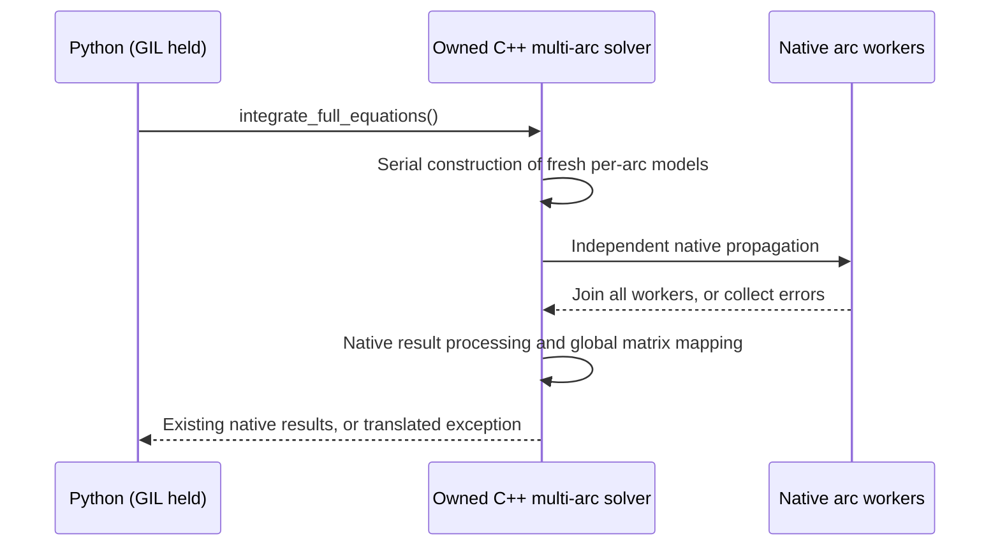

# Python API for isolated native arcs — first supported model

Design decision, 2026-11-11. This extends the native opt-in route described in
`independent_arc_execution.md`; it does not change sequential defaults.

The executable example is [python_independent_arcs.py](../benchmarks/python_independent_arcs.py).
For repeated Python scaling measurements and their timing/validation contract,
see [PYTHON_SCALING.md](../benchmarks/PYTHON_SCALING.md).
This first API is intentionally limited to one supported model; expanding the
model catalogue requires a corresponding isolation/callback audit.

## Public interface

```python
from tudatpy.dynamics import simulator
from tudatpy.data_input.environment_data import spice

spice.load_standard_kernels()
model = simulator.MarsGravityArcModel(degree=20)  # order defaults to degree
simulation = simulator.IndependentArcVariationalSimulator(
    model=model,
    arc_start_times=epochs,       # strictly increasing TDB seconds since J2000
    initial_states=states,       # (number_of_arcs, 6), Mars/J2000, m and m/s
    arc_duration=900.0,           # seconds; common to all arcs
    step_size=30.0,
    number_of_workers=1,          # sequential default
    transfer_state_to_next_arc=False,
)
simulation.set_independent_arc_execution(number_of_workers=4)
simulation.integrate_full_equations()
results = simulation.variational_propagation_results
interface = simulation.state_transition_interface
```

The model is gravity-only JGMRO120D, Cowell, RKDP87 with a fixed step, six
initial-state parameters per arc and one shared Mars gravitational parameter.
No atmosphere, radiation, custom forces, custom termination or Python model
callbacks are accepted. The frame and spacecraft body name are fixed to
Mars/J2000 and Satellite. Degree/order and numerical arc inputs are configurable.
`reference_radius` and `gravitational_parameter` on the immutable model expose
the values read from the installed gravity data for constructing initial states.
The caller loads standard kernels before model creation; no worker loads/unloads
kernels or accesses files during integration.

The Python class composes the existing native multi-arc solver, rather than
inheriting from its mutable Python wrapper. It exposes the **existing native
result and matrix-interface types**, but does not expose parent bodies,
derivative modifiers, mutable propagator settings or the underlying solver.
These escape hatches would allow Python callbacks or model changes after the
native-only safety conditions had been established.

Other public members:

- `initial_states`: copied concatenated initial-state vector, in arc order.
- `parameter_vector`: copied global parameter vector, length `6 * arcs + 1`.
- `reset_parameter_estimate(parameter_vector, reintegrate=True)`.
- `integrate_full_equations(initial_states=None)`: optional copied concatenated
  override; dynamics and variational equations are integrated concurrently.
- `integrate_equations_of_motion_only(initial_states=None)`.
- `propagation_results`: native dynamics results after a successful run.
- `variational_propagation_results` and `state_transition_interface`: available
  after a successful full-equations run, not after a dynamics-only/failed run.
- `number_of_workers`, `last_integration_used_independent_arcs`.
- `clear_independent_arc_execution()`: restore the sequential route.

Construction does not integrate. Changing parameters without reintegration
invalidates current-result access through the wrapper. Returned native result
objects retain their native live/update semantics; they are not immutable
historical snapshots. Do not interpret an old retained reference as a new
successful result after failure or a different integration mode.

Here `reintegrate=False` really defers all propagation. The existing native
`resetParameterEstimate(values, false)` has a different meaning: it propagates
dynamics only. The facade therefore updates the native global/arc-local
parameter sets and initial-state settings explicitly before optionally calling
the existing full-equations integration. It does not change the older API's
meaning or silently perform an extra dynamics run.

## Isolation and lifetime

Python supplies only numerical values and the native model descriptor. Inputs
are copied; no NumPy view, Python callable or `py::object` is captured by a worker
factory. C++ owns the reference environment, settings, parameter set and solver.
Every integration calls the C++ factory serially to construct fresh worker
models using the current local parameters. Captures own their configuration by
value; they do not borrow the Python model or the wrapper's address.

The Mars ephemeris and rotation delegates use one process-local mutex shared by
this binding's contexts. This covers the supported model's SPICE entry points,
not arbitrary C++ code elsewhere in a process. The factory does not reuse the
parent's bodies, acceleration models, caches or integrator settings.

The native solver still performs alias/layout validation, task scheduling,
joining, per-arc result storage, global ephemeris processing and shared-parameter
matrix mapping. No Python arc scheduler or manual matrix merge is introduced.
State-transfer configurations retain the existing latched sequential fallback,
including reintegration after transfer NaNs have been resolved.



Text equivalent: Python enters with the GIL held; C++ first constructs isolated
models serially, then propagates arcs in native threads, joins every worker,
and finally runs the existing result/matrix processing before returning to
Python. Coupled arcs instead take the existing sequential path.

## GIL and callback policy

**Keep the GIL held for this first API**, including factory construction, native
integration and postprocessing. Do not add `gil_scoped_release` or a release
call guard to these methods. The numerical worker threads execute C++ only and
do not need the GIL, so arc parallelism is unaffected. Other Python threads are
blocked during the call, consistently with the existing simulator bindings.

This deliberately prevents Python threads from concurrently reading/mutating
the live native result objects while C++ writes them. A future GIL-releasing API
requires explicit synchronization/snapshot design for those interfaces; releasing
the GIL without that protection is not an optimization to add silently.

There is no Python factory argument to run on worker threads, and no callback
slot in the supported model. In particular, an unrestricted binding of the
native `std::function` factory is deferred: arbitrary Python-built object graphs
can contain callbacks that would block forever waiting for a GIL held by the
joining thread. The first implementation does not use an unchecked
`native_only=True` user assertion. Free-threaded Python and external concurrent
C++ mutation are outside this initial contract.

## Serialization contract for independent arcs

The supported workflow is **integrate successfully, join all workers, then
serialize the completed results serially**. The synchronous integration call
returns only after worker joins and native postprocessing. Do not serialize or
deserialize into a result/model graph while integration, parameter reset or
another operation is modifying that graph. This also applies to retained native
result references: they are live objects, not independent snapshots. After a
failed integration, a retained reference must not be assumed to represent a
complete successful new result.

The current workers perform numerical propagation; they do not access Cereal
archives, and the isolated-model factory does not use Cereal for cloning.
`TUDAT_BUILD_WITH_SERIALIZATION=ON` enables I/O methods, not concurrent archive
access. The tested build uses Cereal's default `CEREAL_THREAD_SAFE=0` and does
not rely on simultaneous serialization from multiple threads.

With the current GIL-enabled Python contract, retaining the GIL prevents other
ordinary Python threads from serializing the live results during integration.
That is not a lock for external C++ threads, nor a free-threaded Python guarantee.
Native callers remain responsible for preventing concurrent mutation/readout.

Concurrent saving, background I/O and in-flight checkpoints are outside this
API contract. Such an extension needs consistent independent snapshots or
synchronization of the full traversed object graph. One archive/stream must
still have only one accessing thread at a time. Concurrent use of separate
archives additionally requires `CEREAL_THREAD_SAFE=1` consistently before Cereal
headers in all participating translation units, including precompiled headers.
That setting protects Cereal's internal bookkeeping, not Tudat's objects. See
[Cereal's thread-safety contract](https://uscilab.github.io/cereal/thread_safety.html).
Saved results are data; they are not a checkpoint of a resumable integrator and
its runtime callbacks. This documents the existing supported workflow; it adds
no locks, snapshot facility or asynchronous I/O.

## Errors and validation

Validate dimensions, finite inputs, increasing epochs, positive duration/step,
at least eight steps per arc, degree/order bounds, initial radii outside the
reference surface and a positive shared gravitational parameter. Constructor
state arrays must be finite. Native state-transfer NaNs are allowed only where
the explicit transfer configuration requires them.

The binding uses pybind11's standard exception translations:
`std::invalid_argument` validation errors become `ValueError`, and native
`std::runtime_error` failures become `RuntimeError`. Type-conversion failures
remain `TypeError`; allocation failures retain their standard `MemoryError`
translation. Worker integration failures include their arc index and are
delivered after all workers join. No Python exception object crosses a worker
boundary. The wrapper marks
current results invalid before a run/reset and only valid after success.

Tests compare the sequential and independent routes on short arcs, cover
input validation, copied-input lifetime, worker selection, result-type identity,
shared-parameter reintegration, retained results after owner deletion,
dynamics-only availability and state-transfer fallback. The documented example
is an executable entry point. These are binding/ownership checks, not proof of
absolute orbit accuracy or a new scalability claim. No long benchmark is a
prerequisite for this API.

## Building and testing

See [Building and validating independent arcs](independent_arc_development.md)
for fresh ON/OFF builds, resource requirements, Python and native test commands,
and serialization regression checks. The [Python test guide](../tests/test_tudatpy/README.md)
describes optional-feature and offline selection. No manual serialization or
network-test exclusions are needed.

The implementation and documentation are AI-assisted. Before broader adoption,
review the native-only model restriction, retained-GIL decision, parameter-reset
semantics and lifetime tests. Automated parity tests do not establish absolute
physical orbit accuracy or replace independent scientific review.
