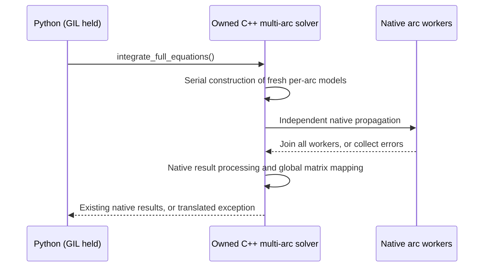

# Python API for isolated native arcs — first supported model

Design decision, 2026-11-11. This extends the native opt-in route described in
`independent_arc_execution.md`; it does not change sequential defaults.

The executable example is [python_independent_arcs.py](../benchmarks/python_independent_arcs.py).
This first API is intentionally limited to one supported model; expanding the
model catalogue requires a corresponding isolation/callback audit.

## Public interface

```python
from tudatpy.dynamics import simulator
from tudatpy.data_input.environment_data import spice

spice.load_standard_kernels()
model = simulator.MarsGravityArcModel(degree=20)  # order defaults to degree
simulation = simulator.IndependentArcVariationalSimulator(
    model=model,
    arc_start_times=epochs,       # strictly increasing TDB seconds since J2000
    initial_states=states,       # (number_of_arcs, 6), Mars/J2000, m and m/s
    arc_duration=900.0,           # seconds; common to all arcs
    step_size=30.0,
    number_of_workers=1,          # sequential default
    transfer_state_to_next_arc=False,
)
simulation.set_independent_arc_execution(number_of_workers=4)
simulation.integrate_full_equations()
results = simulation.variational_propagation_results
interface = simulation.state_transition_interface
```

The model is gravity-only JGMRO120D, Cowell, RKDP87 with a fixed step, six
initial-state parameters per arc and one shared Mars gravitational parameter.
No atmosphere, radiation, custom forces, custom termination or Python model
callbacks are accepted. The frame and spacecraft body name are fixed to
Mars/J2000 and Satellite. Degree/order and numerical arc inputs are configurable.
`reference_radius` and `gravitational_parameter` on the immutable model expose
the values read from the installed gravity data for constructing initial states.
The caller loads standard kernels before model creation; no worker loads/unloads
kernels or accesses files during integration.

The Python class composes the existing native multi-arc solver, rather than
inheriting from its mutable Python wrapper. It exposes the **existing native
result and matrix-interface types**, but does not expose parent bodies,
derivative modifiers, mutable propagator settings or the underlying solver.
These escape hatches would allow Python callbacks or model changes after the
native-only safety conditions had been established.

Other public members:

- `initial_states`: copied concatenated initial-state vector, in arc order.
- `parameter_vector`: copied global parameter vector, length `6 * arcs + 1`.
- `reset_parameter_estimate(parameter_vector, reintegrate=True)`.
- `integrate_full_equations(initial_states=None)`: optional copied concatenated
  override; dynamics and variational equations are integrated concurrently.
- `integrate_equations_of_motion_only(initial_states=None)`.
- `propagation_results`: native dynamics results after a successful run.
- `variational_propagation_results` and `state_transition_interface`: available
  after a successful full-equations run, not after a dynamics-only/failed run.
- `number_of_workers`, `last_integration_used_independent_arcs`.
- `clear_independent_arc_execution()`: restore the sequential route.

Construction does not integrate. Changing parameters without reintegration
invalidates current-result access through the wrapper. Returned native result
objects retain their native live/update semantics; they are not immutable
historical snapshots. Do not interpret an old retained reference as a new
successful result after failure or a different integration mode.

Here `reintegrate=False` really defers all propagation. The existing native
`resetParameterEstimate(values, false)` has a different meaning: it propagates
dynamics only. The facade therefore updates the native global/arc-local
parameter sets and initial-state settings explicitly before optionally calling
the existing full-equations integration. It does not change the older API's
meaning or silently perform an extra dynamics run.

## Isolation and lifetime

Python supplies only numerical values and the native model descriptor. Inputs
are copied; no NumPy view, Python callable or `py::object` is captured by a worker
factory. C++ owns the reference environment, settings, parameter set and solver.
Every integration calls the C++ factory serially to construct fresh worker
models using the current local parameters. Captures own their configuration by
value; they do not borrow the Python model or the wrapper's address.

The Mars ephemeris and rotation delegates use one process-local mutex shared by
this binding's contexts. This covers the supported model's SPICE entry points,
not arbitrary C++ code elsewhere in a process. The factory does not reuse the
parent's bodies, acceleration models, caches or integrator settings.

The native solver still performs alias/layout validation, task scheduling,
joining, per-arc result storage, global ephemeris processing and shared-parameter
matrix mapping. No Python arc scheduler or manual matrix merge is introduced.
State-transfer configurations retain the existing latched sequential fallback,
including reintegration after transfer NaNs have been resolved.



Text equivalent: Python enters with the GIL held; C++ first constructs isolated
models serially, then propagates arcs in native threads, joins every worker,
and finally runs the existing result/matrix processing before returning to
Python. Coupled arcs instead take the existing sequential path.

## GIL and callback policy

**Keep the GIL held for this first API**, including factory construction, native
integration and postprocessing. Do not add `gil_scoped_release` or a release
call guard to these methods. The numerical worker threads execute C++ only and
do not need the GIL, so arc parallelism is unaffected. Other Python threads are
blocked during the call, consistently with the existing simulator bindings.

This deliberately prevents Python threads from concurrently reading/mutating
the live native result objects while C++ writes them. A future GIL-releasing API
requires explicit synchronization/snapshot design for those interfaces; releasing
the GIL without that protection is not an optimization to add silently.

There is no Python factory argument to run on worker threads, and no callback
slot in the supported model. In particular, an unrestricted binding of the
native `std::function` factory is deferred: arbitrary Python-built object graphs
can contain callbacks that would block forever waiting for a GIL held by the
joining thread. The first implementation does not use an unchecked
`native_only=True` user assertion. Free-threaded Python and external concurrent
C++ mutation are outside this initial contract.

## Errors and validation

Validate dimensions, finite inputs, increasing epochs, positive duration/step,
at least eight steps per arc, degree/order bounds, initial radii outside the
reference surface and a positive shared gravitational parameter. Constructor
state arrays must be finite. Native state-transfer NaNs are allowed only where
the explicit transfer configuration requires them.

The binding uses pybind11's standard exception translations:
`std::invalid_argument` validation errors become `ValueError`, and native
`std::runtime_error` failures become `RuntimeError`. Type-conversion failures
remain `TypeError`; allocation failures retain their standard `MemoryError`
translation. Worker integration failures include their arc index and are
delivered after all workers join. No Python exception object crosses a worker
boundary. The wrapper marks
current results invalid before a run/reset and only valid after success.

Tests compare the sequential and independent routes on short arcs, cover
input validation, copied-input lifetime, worker selection, result-type identity,
shared-parameter reintegration, retained results after owner deletion,
dynamics-only availability and state-transfer fallback. The documented example
is an executable entry point. These are binding/ownership checks, not proof of
absolute orbit accuracy or a new scalability claim. No long benchmark is a
prerequisite for this API.

## Build and verification record

Branch `parallellization_inquiry`, base `9a4c3365d`, checked on 2026-11-11.
All five handoff commits (`2873e55d4`, `5efa213d2`, `a7718ee1d`, `fc9d93882`,
`9a4c3365d`) are present. The 2026-11-09 Intel reproduction is prior native
acceptance evidence, not evidence that these new Python bindings were tested
there.

This session uses an AMD Ryzen 9 7900X, the existing `tudatpy-dev` Conda
environment (Python 3.14.6, GCC 14.4.0, pybind11 3.0.3), and a fresh
`build-python-arcs` directory. Cereal was missing from that environment; an
already available Cereal 1.3.2 prefix at `/tmp/tudat-cereal-prefix` was supplied
as a second `CMAKE_PREFIX_PATH` entry. A clean machine should first install the
dependencies declared in `environment.yaml`, including Cereal, rather than
assuming that temporary path exists. No dependencies were upgraded in place.
The installed resource package is `tudat-resources` 2.4 (`h68c723b_5`).
Public package imports also required restoring the already declared
`atdf2ascii` dependency: version 1.0.0, upstream commit
`ae11cb1438d2843923272caee4eda69ea476fa93`, plus its missing dependencies
`bitstring` 5.0.0, `termcolor` 3.3.0 and `tibs` 2.0.2. These were added to the
development environment with permission; no unrelated packages were upgraded.

Building with serialization disabled exposed four existing unused
`tudat::serialization` namespace aliases in the acceleration, dependent-variable,
propagator and torque bindings. Removing those aliases lets that supported build
configuration compile; serialization behaviour itself is unchanged.

From the repository root, with that development environment activated:

```bash
cmake -S . -B build-python-arcs -G 'Unix Makefiles' \
  -DCMAKE_CXX_COMPILER="$CONDA_PREFIX/bin/x86_64-conda-linux-gnu-c++" \
  -DCMAKE_C_COMPILER="$CONDA_PREFIX/bin/x86_64-conda-linux-gnu-cc" \
  -DCMAKE_PREFIX_PATH="$CONDA_PREFIX" \
  -DCMAKE_BUILD_TYPE=Release -DTUDAT_BUILD_TESTS=ON \
  -DTUDAT_BUILD_WITH_SERIALIZATION=OFF \
  -DTUDAT_BUILD_WITH_EXTENDED_PRECISION_PROPAGATION_TOOLS=OFF \
  -DTUDAT_BUILD_EXPLICIT_INSTANTIATIONS=ON \
  -DCCACHE_PROGRAM=CCACHE_PROGRAM-NOTFOUND
cmake --build build-python-arcs --target kernel -j 4
PYTHONPATH=build-python-arcs/src python benchmarks/python_independent_arcs.py
PYTHONPATH=build-python-arcs/src python -m pytest \
  tests/test_tudatpy/test_independent_arc_execution.py --no-remote-data -q
PYTHONPATH=build-python-arcs/src python -m pytest tests/test_tudatpy --no-remote-data -q
```

The compiler paths above are the Linux Conda toolchain used here; select the
corresponding compiler on another platform. Existing installed Python packages
must not substitute for the freshly built module. Serialization was explicitly
disabled in this build; serialization tests do not validate that optional
feature under this configuration.

Verification on this machine:

- Release `kernel` build succeeds, including the new bindings with the actual
  Python `Time`/state scalar types.
- Executable example succeeds: native independent execution is true, 21 saved
  states in each of two arcs, global matrix shape `(6, 13)`.
- New Python regression file: **22 passed**. This includes sequential/parallel
  parity, shared mu updates, copied inputs, retained native results/interfaces,
  deferred reset without hidden integration, dynamics-only mode, latched
  state-transfer fallback, validation and worker-failure recovery.
- All three documented native CTests pass in the fresh build (independent arc
  acceptance, concurrent coefficient lookup, RKDP87 integration).
- Unfiltered Python suite with `--no-remote-data`: **660 passed, 209 failed,
  114 skipped, 1 xfailed**. Of those failures, 207 are in the two serialization
  test files and require the deliberately disabled optional feature. The other
  two are unmarked network downloads in the GRAIL/MRO residual tests, blocked by
  sandbox DNS. This is not an all-features/full-suite pass.

For this serialization-OFF, offline configuration, run the remaining suite
explicitly as follows (rather than silently changing/marking unrelated tests):

```bash
PYTHONPATH=build-python-arcs/src python -m pytest tests/test_tudatpy --no-remote-data \
  --ignore=tests/test_tudatpy/test_serialization_file_io.py \
  --ignore=tests/test_tudatpy/test_serialization_pickle.py \
  -k 'not test_odf_grail_short_arc_residuals_are_millihertz_level and not test_tnf_mro_short_arc_residuals_are_low_after_compression' -q
```

This configuration-specific run passes: **652 passed, 104 skipped,
2 deselected**. The count differs from the unfiltered run because both whole
serialization test modules are excluded, including the tests in them that did
not fail. Existing deprecation warnings remain. Black, clang-format and
`git diff --check` pass for the new/changed feature files.

The native test build/run commands are:

```bash
cmake --build build-python-arcs --target copy_test_data \
  test_propagators_IndependentArcExecution test_integrators_RungeKuttaCoefficients \
  test_integrators_RungeKutta87DormandPrinceIntegrator -j 2
ctest --test-dir build-python-arcs \
  -R '^test_(propagators_IndependentArcExecution|integrators_RungeKuttaCoefficients|integrators_RungeKutta87DormandPrinceIntegrator)$' \
  --output-on-failure
```

The design, binding implementation, tests and example in this change were
AI-assisted. Automated verification does not constitute independent human
review of the API contract or scientific validation of the orbit model.
Before merging, review the native-only model restriction, retained-GIL decision,
parameter-reset semantics and lifetime tests in particular. The short example
provides a concrete entry point for that review. General testing references:
[pytest](https://docs.pytest.org) and
[CodeRefinery's testing lesson](https://coderefinery.github.io/testing/).
Project-wide AI declaration/citation metadata and agent-directory ignore
policies remain outside this feature, as in the previous session. The bundled
practice checker still reports the pre-existing missing `CITATION.cff` and
agent-directory ignore entries; its artifact-floor implementation does not
honour a scoped waiver for those two checks.
